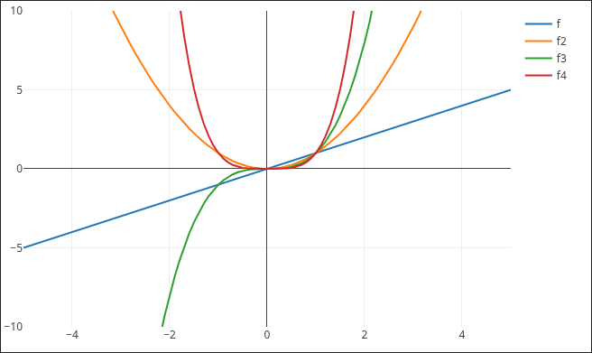

# Graphpaper

Graphpaper is an Obsidian plugin to display interactive math plots in notes.

This plugin aims for an easy and readable way to describe your plot.

## How to use?

### Basic usage

A Graphpaper can be created by adding a code block with the `graphpaper` type.
The plugin comes with a command `Insert Graphpaper plot` that opens a GUI to configure the plot and create the code block for you.

See the [wiki](https://github.com/Fir0x/obsidian-graphpaper-plugin/wiki/Usage) for more.

## FAQ

### What is used to create the plot?

Graphpaper is powered by [Plotly.js](https://github.com/plotly/plotly.js/).

### Was any LLM involved with this project?

I am new to Typescript, so Claude was used to complement to the official
documentations and forums to learn the language and best practices.

However, this project was not vibecoded in any way as I stand against that.
